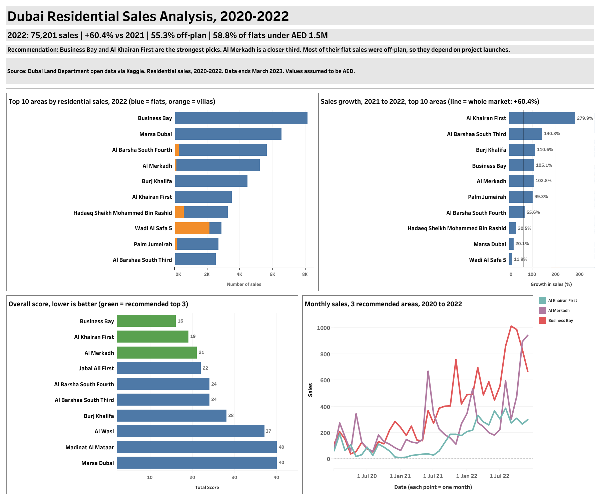

# dubai-property-sales-analysis
SQL Server and Tableau analysis of Dubai Land Department sales data, 2020-2022: where should a brokerage focus its marketing?
# Dubai Residential Sales Analysis, 2020-2022
### Where should a property brokerage focus its marketing budget?

**Live dashboard:**
[https://public.tableau.com/app/profile/ayesha.nisar/viz/DubaiResidentialSalesAnalysis/DubaiPropertySales2020-2022]

> **Note:** This is a portfolio project. The brokerage, the manager and the budget in the scenario are fictional. The data is real.

---

## 1. Business problem

A Dubai property brokerage has a limited marketing budget for the next quarter. The marketing manager needs to know which areas to focus on.

**Decision to support:** Which 3 areas should the brokerage target, and why?

**Answer:** Business Bay and Al Khairan First are the strongest picks. Al Merkadh is a closer third. Most of their flat sales were off-plan, so they depend on project launches.

---

## 2. Data

- **Source:** Dubai Land Department (DLD) open transaction data, downloaded from Kaggle ("Dubai Real Estate Transactions Dataset" by Alex Efimik). [https://www.kaggle.com/datasets/alexefimik/dubai-real-estate-transactions-dataset]
- **Size:** 1,047,965 transaction rows, from 7 March 1995 to 17 March 2023.
- **Tools:** Microsoft SQL Server (cleaning and analysis), Tableau Public (dashboard).

**Scope used in this analysis**
- **Transaction type:** Sales only (787,892 rows). Mortgages and gifts are excluded.
- **Sale types:** Sell, Sell - Pre registration and Delayed Sell (92.6% of sales rows). 14 other types, such as development and lease-to-own registrations, are excluded.
- **Property types:** Flats (property type "Unit", sub-type "Flat") and Villas. Land, buildings, hotel units and commercial units are excluded.
- **Period:** 2020 to 2022, which are three full years. 2023 is excluded because the data stops in March.

---

## 3. Questions

**Q1. Demand: Which 10 areas had the most residential sales in 2022?**
Count of sales per area in 2022, top 10. More sales means more buyers and sellers to reach.

**Q2. Price level: What is the middle price per sqm in each of those areas, and how does it compare with the Dubai-wide middle price?**
Median price per sqm, flats and villas separately. The median is used because a few luxury deals pull the average up. Groups with fewer than 30 sales are hidden.

**Q3. Momentum: Which areas had the biggest rise or fall in sales from 2021 to 2022?**
Percentage change in sales. Only areas with at least 100 sales in 2021 are included, so tiny areas don't produce misleading percentages.

**Q4. Off-plan vs ready: What share of each area's 2022 sales was off-plan?**
Off-plan means the registration type is "Off-Plan Properties". Only areas with at least 100 sales in 2022 are included.

**Q5. Entry-level flats: Which areas had the most flat sales under 1.5 million in 2022?**
The value column is assumed to be in AED.

**Q6. Recommendation: Using Q1, Q3 and Q5, which 3 areas rank best?**
Each area is ranked on 2022 sales (Q1), growth (Q3) and flats under 1.5M (Q5). The three ranks are added, and the lowest total wins. Ties go to the area with more 2022 sales. Q2 and Q4 are used as context and risk notes, not in the score.

---

## 4. Cleaning log

| Step | Rows left | Rows removed |
|---|---|---|
| All rows loaded | 1,047,965 | - |
| Sales only | 787,892 | 260,073 |
| Three sale types (Sell, Sell - Pre registration, Delayed Sell) | 729,915 | 57,977 |
| Flats and villas only | 580,111 | 149,804 |
| 2020 to 2022 only | 148,546 | 431,565 |
| Value, price and size above zero | 148,534 | 12 |
| Price per sqm between 1,000 and 100,000 | 148,397 | 137 |

**Other data notes**
- Dates were stored as day-month-year text and were converted with an explicit format. The default format read about 62% of them wrongly or not at all. 5 rows had no date and were excluded by the date filter.
- 3,805 rows (across all transaction types) had the text "null" in the value column. They were converted to empty values and excluded from price analysis.
- 128,330 villa rows had no sub-type. Villas were selected by property type instead, so none were lost.
- "Hotel Apartment" units were treated as a separate type and excluded from flats.
- The price per sqm column matches value divided by size in all 148,397 clean rows (within 5%).
- Area names are kept as they appear in the data. Spelling is inconsistent in the source, but I found no obvious zone split across two spellings.
- All 76,631 clean "Sell - Pre registration" rows are labeled off-plan, and none of the "Sell" or "Delayed Sell" rows are.
- Clean sales per year: 2020 had 26,319, 2021 had 46,877 and 2022 had 75,201.

---

## 5. Method choices

- **Price per sqm** uses the price per sqm column from the data. Price per sqft = price per sqm divided by 10.764.
- **Median** is used instead of the average.
- **Minimum size rule:** areas need at least 100 sales in 2021 to be scored for growth. 47 areas qualify.
- **Equal weights:** the score counts demand, growth and entry-level flats equally. This is a choice, not a fact.
- **Stability check:** the score was re-run leaving out one rank at a time.

---

## 6. Findings

1. **Demand is concentrated.** The top 10 areas made up 59.5% of 2022 residential sales (44,769 of 75,201). Business Bay led with 8,123 sales (10.8%), followed by Marsa Dubai with 6,549 (8.7%).
2. **Most top areas are flat markets.** Seven of the top 10 areas were at least 95% flats. Wadi Al Safa 5 is the only villa-led area, with 2,120 of its 2,839 sales (74.7%) being villas.
3. **Growth was uneven.** Market sales grew 60.4% from 2021 to 2022 (46,877 to 75,201). Of the 47 areas with 100+ sales in 2021, 22 grew faster than the market and 11 sold less in 2022. Three of the top 10 areas grew slower than the market: Marsa Dubai (+20.1%), Hadaeq Sheikh Mohammed Bin Rashid (+30.5%) and Wadi Al Safa 5 (+11.9%).
4. **Over half of 2022 sales were off-plan.** 41,559 of 75,201 sales (55.3%). Eight of the top 10 areas were more than half off-plan. Al Merkadh was the highest at 90.9% (4,743 of 5,219).
5. **High demand does not mean high price.** Palm Jumeirah flats had the highest median price per sqm at 32,110, which is 99.2% above the Dubai flat median of 16,119. Al Barsha South Fourth had the third-most sales, but its flats were 37.8% below the Dubai median.
6. **Entry-level flats are concentrated.** 58.8% of 2022 flat sales were under 1.5M (36,448 of 62,026). Al Barsha South Fourth had the most, with 5,290 of its 5,388 flat sales (98.2%).

---

## 7. Recommendation

**Focus on Business Bay and Al Khairan First. Al Merkadh is a closer third.**

| Area | Score (demand / growth / flats under 1.5M) | Why | Risk |
|---|---|---|---|
| Business Bay | 16 (1st / 13th / 2nd) | Most sales in 2022 (8,123), +105.1% growth, 5,074 flats under 1.5M | 67.5% of its flat sales were off-plan |
| Al Khairan First | 19 (6th / 3rd / 10th) | 3,510 sales, +279.9% growth, 1,134 flats under 1.5M | Growth is from a low base (924 sales in 2021). 76.2% of flat sales were off-plan. Only 32.3% of its flats sold under 1.5M |
| Al Merkadh | 21 (4th / 14th / 3rd) | 5,219 sales, +102.8% growth, 3,691 flats under 1.5M | 92.3% of flat sales were off-plan. Sales were uneven: November and December 2022 were 35.2% of its year |

**How stable is this?**
- Business Bay and Al Khairan First were in the top 3 under 3 of the 4 scoring rules (all three ranks, and each pair of ranks).
- Al Merkadh was in the top 3 under only 2 of the 4 rules. Jabal Ali First was one point behind it on the main score (22 vs 21).
- Third place changes with how the factors are weighted.

---

## 8. Limitations

- The data ends on 17 March 2023. This analysis shows past patterns, not today's market.
- 2023 is excluded because it is a partial year. 2020 was affected by COVID, so its numbers are unusual.
- The data is a Kaggle copy of DLD open data. It was not downloaded from the official portal.
- Values are assumed to be in AED. I could not confirm the currency from the dataset description.
- The sale types kept (three of 17) and the price per sqm bounds (1,000 to 100,000, which removed 137 rows) are judgment calls.
- Prices and values are registered transaction values. Off-plan and ready sales are mixed together in the price figures.
- Percentages can mislead on small bases. For example, Al Khairan First's +279.9% is measured against a low 2021 total.
- The analysis describes what happened. It does not explain why, and it does not predict what will happen.
- The brokerage and the business question are fictional.

---

## 9. Files in this repository

- `01_cleaning.sql`: data checks, cleaning steps and the row-count log
- `02_q1_demand.sql`: Q1, top areas by sales
- `03_q2_price_level.sql`: Q2, median price per sqm
- `04_q3_momentum.sql`: Q3, growth from 2021 to 2022
- `05_q4_offplan_share.sql`: Q4, off-plan share
- `06_q5_entry_level.sql`: Q5, flats under 1.5M
- `07_q6_recommendation.sql`: Q6, scoring and the stability check
- `08_trend_top3.sql`: monthly sales for the 3 recommended areas
- `dashboard.png`: screenshot of the dashboard

The raw data file is not included. Download it from the Kaggle link above.

## 10. Skills shown

- **SQL Server:** data cleaning, CTEs, joins, CASE expressions, window functions (RANK, PERCENTILE_CONT, SUM OVER), type conversion with TRY_CAST and TRY_CONVERT
- **Tableau Public:** bar and line charts, reference line, calculated fields, dashboard layout, hover tooltips
- **Analysis:** defining a business question, handling messy data, documenting decisions, checking results against each other
